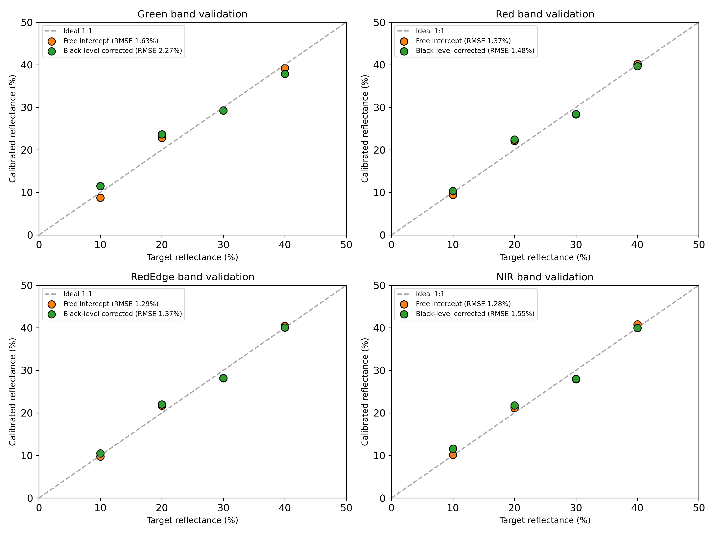

# DJI M3M Empirical Line Calibration

[](LICENSE)
[](https://www.python.org/)
[](dn_to_reflectance.ipynb)


Converts DJI Mavic 3 Multispectral (M3M) DN orthomosaics to surface reflectance with the Empirical Line Method (ELM). The model is fitted per band from one capture that contains four reference tarps with 10, 20, 30 and 40% reflectance.

Metashape's built-in radiometric calibration uses a single reflectance target. This notebook fits a linear model per band to all four reflectance levels and compares it with a black-level-corrected model forced through the origin, which follows the single-panel assumption.



<sub>Calibrated against target reflectance at the tarps, with RMSE for the free-intercept and black-level-corrected models.</sub>

## Requirements

- Python 3.10 or later. Pinned package versions are in [`requirements.txt`](requirements.txt).
- A Jupyter session with a display. The ROI selection step opens OpenCV windows, so it does not run headless (for example over SSH without X forwarding, or in CI).

```bash
pip install -r requirements.txt
```

## Data

**No imagery is included.** The drone captures used to develop the notebook belong to the research institution where they were collected and are not redistributed. The [`examples/`](examples/) folder has the figures from an actual run.

| Figure | Content |
|:--|:--|
| [`elm_fit.png`](examples/elm_fit.png) | Free-intercept ELM fit per band (DN against tarp reflectance) |
| [`elm_model_comparison.png`](examples/elm_model_comparison.png) | Free-intercept and black-level-corrected models extrapolated to DN = 0 |
| [`elm_validation.png`](examples/elm_validation.png) | Calibrated against target reflectance at the tarps, with RMSE per band |

Set the input and output locations with environment variables, or edit the defaults in the notebook's config cell.

| Variable | Content | Default |
|:--|:--|:--|
| `DJI_M3M_TARP_DIR` | Folder with the four single-band tarp images (`tarp_green.tif`, `tarp_red.tif`, `tarp_rededge.tif`, `tarp_nir.tif`) | `./data/tarps` |
| `DJI_M3M_MAIN_DN_PATH` | DN orthomosaic to calibrate, band order Green, Red, RedEdge, NIR | `./data/sample_dn_orthomosaic.tif` |
| `DJI_M3M_OUTPUT_DIR` | Folder for the calibrated GeoTIFFs and figures | `./output/` |

`data/` and `output/` are ignored by git.

```powershell
# Windows PowerShell
$env:DJI_M3M_TARP_DIR = "D:\data\DJI_M3M\<site>\<date>\<flight>\"
$env:DJI_M3M_MAIN_DN_PATH = "D:\projects\drone\Metashape\<site>\<ortho>.tif"
jupyter lab dn_to_reflectance.ipynb
```

```bash
# macOS / Linux
export DJI_M3M_TARP_DIR="/path/to/tarps"
export DJI_M3M_MAIN_DN_PATH="/path/to/orthomosaic.tif"
jupyter lab dn_to_reflectance.ipynb
```

## Workflow

Run [`dn_to_reflectance.ipynb`](dn_to_reflectance.ipynb) from top to bottom in an interactive session.

1. **Config:** checks that all input files exist.
2. **ROI selection:** for each band, drag a box around the tarps, then click the corners of each tarp from 10% to 40%. This step is manual because the tarps are not axis-aligned and the optical centers differ slightly between bands.
3. **Model fitting:** fits the free-intercept and black-level-corrected models per band and plots the fits.
4. **Apply and export:** applies both models to the full orthomosaic and writes two calibrated GeoTIFFs.
5. **Validation:** compares calibrated reflectance at the tarps with the known values and reports RMSE per band.

## License

Released under the [MIT License](LICENSE).

## Contact

Seongjun Lee ([@SeongjunLee4473](https://github.com/SeongjunLee4473))
